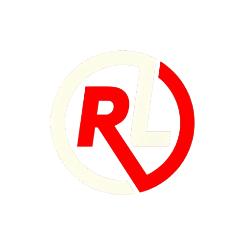

<!-- ═══════════════════════════════════════════════════════════════ -->
<!--                    LAYRAGA OFFICIAL PROFILE                     -->
<!-- ═══════════════════════════════════════════════════════════════ -->

<div align="center">


<a href="https://github.com/LAYRAGA-OFFICIAL">
  
</a>

<br/><br/>

<a href="https://github.com/LAYRAGA-OFFICIAL">
  
</a>

<br/>

<p>
  <a href="https://github.com/LAYRAGA-OFFICIAL">
    
  </a>
  <a href="https://github.com/LAYRAGA-OFFICIAL">
    
  </a>
  
</p>

<p>
  <a href="https://github.com/LAYRAGA-OFFICIAL">
    
  </a>
  <a href="https://twitter.com/layraga_official">
    
  </a>
  <a href="mailto:hello@layraga.com">
    
  </a>
  <a href="https://layraga.com">
    
  </a>
</p>


<br/><br/>


</div>

<!-- ═══════════════════════════════════════════════════════════════ -->
<!--                        ABOUT SECTION                            -->
<!-- ═══════════════════════════════════════════════════════════════ -->

<div align="center">

##  About Us

</div>

<table align="center" border="0">
<tr>
<td width="50%" valign="top">

### 🚀 Who We Are

**LAYRAGA OFFICIAL** is an independent software studio focused on building **modern, useful, and open-source applications**.

We believe great software should be:

| | |
|---|---|
| 🆓 **Free & Open** | Accessible to everyone |
| 🎨 **Beautiful** | Great UX matters |
| ⚡ **Fast** | Performance first |
| 🔒 **Secure** | Privacy by design |
| 🌍 **Global** | Built for the world |

</td>
<td width="50%" valign="top">

<div align="center">

### 💬 Our Motto

<br/>

<a href="#">
  
</a>

<br/><br/>


</div>

</td>
</tr>
</table>

<div align="center">

</div>

<!-- ═══════════════════════════════════════════════════════════════ -->
<!--                      PROJECTS SECTION                           -->
<!-- ═══════════════════════════════════════════════════════════════ -->

<div align="center">

##  What We're Building

</div>

<table align="center" width="100%">
<tr>
<td width="50%" align="center">

### 🌐 Hublr

<br/>

<a href="https://github.com/LAYRAGA-OFFICIAL/hublr">
  
</a>

<br/><br/>

<a href="https://github.com/LAYRAGA-OFFICIAL/hublr">
  
</a>
<br/><br/>


</td>
<td width="50%" align="center">

### 🔍 Scanlr

<br/>

<a href="https://github.com/LAYRAGA-OFFICIAL/scanlr">
  
</a>

<br/><br/>

<a href="https://github.com/LAYRAGA-OFFICIAL/scanlr">
  
</a>
<br/><br/>


</td>
</tr>
</table>

<div align="center">

<br/>

> 📌 **Check out our repositories above!** Explore, contribute, or submit issues.
> ⭐ **Star & watch** our projects to support development.

<br/>


</div>

<!-- ═══════════════════════════════════════════════════════════════ -->
<!--                        MISSION SECTION                          -->
<!-- ═══════════════════════════════════════════════════════════════ -->

<div align="center">

##  Our Mission

**To build high-quality, open-source applications that solve real problems and make technology more accessible for everyone.**

</div>

<table align="center" width="100%">
<tr>
<td width="25%" align="center">
  
  <br/>
  <b>💡 Innovation</b>
  <br/>
  <sub>Solving problems in new ways</sub>
</td>
<td width="25%" align="center">
  
  <br/>
  <b>🌐 Community</b>
  <br/>
  <sub>Building in public, together</sub>
</td>
<td width="25%" align="center">
  
  <br/>
  <b>🎓 Learning</b>
  <br/>
  <sub>Sharing knowledge through code</sub>
</td>
<td width="25%" align="center">
  
  <br/>
  <b>❤️ Craftsmanship</b>
  <br/>
  <sub>Doing things right, not just fast</sub>
</td>
</tr>
</table>

<div align="center">

</div>

<!-- ═══════════════════════════════════════════════════════════════ -->
<!--                        VALUES SECTION                           -->
<!-- ═══════════════════════════════════════════════════════════════ -->

<div align="center">

##  Our Core Values

</div>

<table align="center" width="100%">
<tr>
<td align="center" width="33%">

### 🔓 Open Source First


<br/><br/>

Code should be free and accessible to everyone, everywhere.

</td>
<td align="center" width="33%">

### 🎨 Design Matters


<br/><br/>

Beautiful tools are better tools. UX is not optional.

</td>
<td align="center" width="33%">

### 🔐 Privacy First


<br/><br/>

User data belongs to users. Period.

</td>
</tr>
<tr>
<td align="center" width="33%">

### 🚀 Ship Fast


<br/><br/>

Iterate, learn, improve. Perfection is the enemy of progress.

</td>
<td align="center" width="33%">

### 🤝 Build in Public


<br/><br/>

Share the journey, not just the result. Transparency wins.

</td>
<td align="center" width="33%">

### ⚡ Performance


<br/><br/>

Every millisecond counts. Speed is a feature.

</td>
</tr>
</table>

<div align="center">

</div>

<!-- ═══════════════════════════════════════════════════════════════ -->
<!--                        TECH STACK SECTION                       -->
<!-- ═══════════════════════════════════════════════════════════════ -->

<div align="center">

##  Tech Stack

<br/>

### 🎨 Frontend
<p>
  
</p>

### ⚙️ Backend
<p>
  
</p>

### 🗄️ Database & Cloud
<p>
  
</p>

### 🛠️ Tools
<p>
  
</p>

</div>

<div align="center">

</div>

<!-- ═══════════════════════════════════════════════════════════════ -->
<!--                        GITHUB STATS SECTION                     -->
<!-- ═══════════════════════════════════════════════════════════════ -->

<div align="center">

##  GitHub Analytics

<br/>

<a href="https://github.com/LAYRAGA-OFFICIAL">
  
  
</a>

<br/><br/>

<a href="https://github.com/LAYRAGA-OFFICIAL">
  
</a>

<br/><br/>

<a href="https://github.com/LAYRAGA-OFFICIAL">
  
</a>

<br/><br/>


</div>

<div align="center">

</div>

<!-- ═══════════════════════════════════════════════════════════════ -->
<!--                        ROADMAP SECTION                          -->
<!-- ═══════════════════════════════════════════════════════════════ -->

<div align="center">

##  Roadmap 2026

</div>

```mermaid
%%{init: {'theme':'dark', 'themeVariables': { 'primaryColor':'#00d9ff','primaryTextColor':'#fff','primaryBorderColor':'#ec4899','lineColor':'#8b5cf6','secondaryColor':'#ec4899','tertiaryColor':'#0d1117'}}}%%
timeline
    title LAYRAGA OFFICIAL Journey
    section Q1 2026
        Foundation : Organization Setup
                   : Hublr Core Development
                   : Scanlr Initial Build
    section Q2 2026
        Launch : Hublr & Scanlr Public Release
               : Open Source Documentation
               : Community Outreach
    section Q3 2026
        Growth : Feature Enhancements
               : Contributor Program
               : v2.0 Releases
    section Q4 2026
        Scale : Platform Integration
              : Global Community Expansion
              : Annual Review
